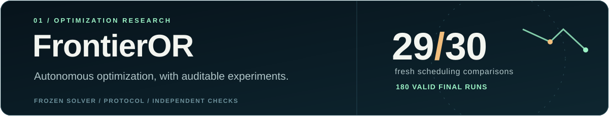
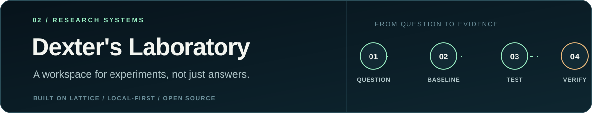
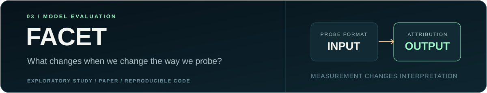

<picture>
  <source media="(prefers-color-scheme: dark)" srcset="assets/hero-dark.svg">
  <source media="(prefers-color-scheme: light)" srcset="assets/hero-light.svg">
  
</picture>

  <a href="#selected-work">Research</a> &nbsp; / &nbsp;
  <a href="#open-source-contributions">Open source</a> &nbsp; / &nbsp;
  <a href="#background">Background</a> &nbsp; / &nbsp;
  <a href="https://venkat-rj.github.io/">Portfolio</a> &nbsp; / &nbsp;
  <a href="https://www.linkedin.com/in/venkateshwar-jambula/">LinkedIn</a>

I am a researcher, engineer, and technical founder working at the intersection of **autonomous research, optimization, and reliable AI systems**.

I am interested in a specific question: **How do we build systems that can investigate unfamiliar problems, challenge their own assumptions, and produce evidence we can actually verify?**

## Selected work

<a href="https://github.com/Venkat-RJ/openresearch">
<picture>
  <source media="(prefers-color-scheme: dark)" srcset="assets/frontieror-dark.svg">
  <source media="(prefers-color-scheme: light)" srcset="assets/frontieror-light.svg">
  
</picture>
</a>

**[FrontierOR](https://github.com/Venkat-RJ/openresearch)** · [Study](https://github.com/Venkat-RJ/openresearch/tree/main/frontieror/scheduling-study) · [Verification](https://github.com/Venkat-RJ/openresearch/blob/main/frontieror/scheduling-study/README.md)

A frozen, agent-developed solver beat a historical EGRASP implementation on **29 of 30 fresh synthetic scheduling instances** by three-run mean weighted tardiness. The study includes 180 valid final executions, saved protocols, source code, and independent checks. This is a bounded experimental result, not a state-of-the-art claim.

<a href="https://github.com/Venkat-RJ/dexters-laboratory-v1">
<picture>
  <source media="(prefers-color-scheme: dark)" srcset="assets/dexter-dark.svg">
  <source media="(prefers-color-scheme: light)" srcset="assets/dexter-light.svg">
  
</picture>
</a>

**[Dexter's Laboratory](https://github.com/Venkat-RJ/dexters-laboratory-v1)** · [Source and setup](https://github.com/Venkat-RJ/dexters-laboratory-v1#build-from-source)

An experimental, local-first research workspace **built on Lattice**. It brings problem formulation, prior knowledge, experiment planning, bounded runs, validation, and research records together. The repository identifies its upstream foundation and documents the source installation.

<a href="https://github.com/Venkat-RJ/facet-benchmark">
<picture>
  <source media="(prefers-color-scheme: dark)" srcset="assets/facet-dark.svg">
  <source media="(prefers-color-scheme: light)" srcset="assets/facet-light.svg">
  
</picture>
</a>

**[FACET](https://github.com/Venkat-RJ/facet-benchmark)** · [Paper](https://github.com/Venkat-RJ/facet-benchmark/blob/main/FACET_paper.pdf) · [Research archive](https://doi.org/10.5281/zenodo.19557436)

An exploratory study of attribution faithfulness in multi-factor LLM reasoning. It examines how the *measurement method* can change the apparent behavior of a model. Includes a paper, code, and raw experimental outputs. Findings are limited to the studied cases and probes.

## Open-source contributions

| Project | Engineering contributions | Status |
| :--- | :--- | :--- |
| **[Talos](https://github.com/cajal-technologies/talos)** | WebAssembly interpreter validation in Lean: [tables](https://github.com/cajal-technologies/talos/pull/253), [uninitialized locals](https://github.com/cajal-technologies/talos/pull/250), [typed select](https://github.com/cajal-technologies/talos/pull/255) | 3 merged PRs |
| **[Sagent](https://github.com/rekursiv-ai/sagent)** | Worker-message attribution, pending-work visibility, CLI reliability: [#633](https://github.com/rekursiv-ai/sagent/pull/633), [#636](https://github.com/rekursiv-ai/sagent/pull/636) | Open PRs |
| **[Hermes / TallySeal](https://github.com/Venkat-RJ/hermes-tallyseal)** | Deterministic grouped-CSV verification and byte-exact release checks | [Catalog PR merged](https://github.com/NousResearch/hermes-agent/pull/153588) |

Other experiments: **[CoherenceBench](https://github.com/Venkat-RJ/coherencebench)**, an exploratory test of changing decisions in long-running monitoring tasks. Its results are preliminary and constrained to the test harness.

## Background

I founded PranaAlpha Labs and built AI products and knowledge infrastructure for agents. Before that, I worked across research, embedded systems, optimization, AI engineering, and technical leadership at **Samsung Research, Bosch, Continental, and Sigmoid**.

I care about the path from **question → experiment → result → independent verification**. The code is important, but so is knowing what the evidence does and does not establish.

  <a href="https://venkat-rj.github.io/">Portfolio</a> &nbsp; · &nbsp;
  <a href="https://www.linkedin.com/in/venkateshwar-jambula/">LinkedIn</a> &nbsp; · &nbsp;
  <a href="https://github.com/Venkat-RJ?tab=repositories">Repositories</a>

