<picture>
  <source media="(prefers-reduced-motion: reduce) and (prefers-color-scheme: dark)" srcset="media/experiment-dark-static.svg">
  <source media="(prefers-reduced-motion: reduce) and (prefers-color-scheme: light)" srcset="media/experiment-light-static.svg">
  <source media="(prefers-color-scheme: dark)" srcset="media/experiment-dark.svg">
  <source media="(prefers-color-scheme: light)" srcset="media/experiment-light.svg">
  
</picture>

The experiment that fought back. Original 32-second SVG animation, illustrated and built for this README.

**[Research](#selected-research) · [Building](#currently-building) · [Open source](#in-the-open) · [Writing](https://venkat-rj.github.io/) · [LinkedIn](https://www.linkedin.com/in/venkateshwar-jambula/)**

I work on **autonomous research, optimization and reliable AI systems**. The question I keep returning to is whether an agent can do more than follow a plan: can it *formulate a problem, challenge its assumptions, run useful experiments and know what its evidence actually establishes?*

## Selected research

### 01 / FrontierOR: putting an AI-developed solver to the test

<picture>
  <source media="(prefers-color-scheme: dark)" srcset="media/frontieror-dark.svg">
  <source media="(prefers-color-scheme: light)" srcset="media/frontieror-light.svg">
  
</picture>

A frozen, agent-developed C++ solver outperformed the historical EGRASP reference on **29 of 30 fresh synthetic scheduling instances** by three-run mean weighted tardiness. All **180 final executions** produced valid schedules. The study preserves the protocol, source, data and independent checks, including the one instance that favored the comparator. It is a result on this tested distribution, not a state-of-the-art claim.

[Research archive](https://github.com/Venkat-RJ/openresearch) · [Study and limitations](https://github.com/Venkat-RJ/openresearch/tree/main/frontieror/scheduling-study) · [Verify saved results](https://github.com/Venkat-RJ/openresearch/blob/main/frontieror/README.md)

### 02 / FACET: the measurement can change the answer

<table><tr>
<td width="55%" valign="top">

</td>
<td valign="top">

An exploratory experiment on **attribution faithfulness in multi-factor LLM reasoning**. Different ways of asking a model which factors mattered can produce different assessments of its behavior.

The paper, raw outputs and code are public. This is an exploratory pilot, not a validated general-purpose benchmark.

[Experiment and code](https://github.com/Venkat-RJ/facet-benchmark) · [Paper](https://github.com/Venkat-RJ/facet-benchmark/blob/main/FACET_paper.pdf) · [Archive](https://doi.org/10.5281/zenodo.19557436)

</td>
</tr></table>

## Currently building

**[Dexter's Laboratory](https://github.com/Venkat-RJ/dexters-laboratory-v1)** is an experimental research workspace built on [Lattice](https://github.com/leo1oel/lattice). It brings together problem formulation, literature, branching ideas, controlled experiment execution and a persistent research record. Local-first, source-available, and still evolving.

The aim isn't another chat window. It's a place where the reasoning, attempts, failures and evidence of a research investigation can remain inspectable.

## In the open

| Project | Work | Status |
| :--- | :--- | :--- |
| [**Talos**](https://github.com/cajal-technologies/talos) | WebAssembly validation in Lean: [table declarations](https://github.com/cajal-technologies/talos/pull/253), [uninitialized locals](https://github.com/cajal-technologies/talos/pull/250), [typed select](https://github.com/cajal-technologies/talos/pull/255) | Three merged PRs |
| [**Sagent**](https://github.com/rekursiv-ai/sagent) | Agent-message attribution and persistent pending-work visibility ([#633](https://github.com/rekursiv-ai/sagent/pull/633), [#636](https://github.com/rekursiv-ai/sagent/pull/636)) | Proposed, open PRs |
| [**TallySeal**](https://github.com/Venkat-RJ/hermes-tallyseal) | A Hermes Agent plugin for byte-exact release checks and grouped CSV verification | [Catalog PR merged](https://github.com/NousResearch/hermes-agent/pull/153588) |

Previously: founded PranaAlpha Labs; engineering and research across **Samsung Research, Bosch, Continental and Sigmoid**.

Animation is a fictional illustration of the research process, not footage of an experimental result. The FrontierOR figure is generated directly from the study's published 30-instance CSV; source and verification are in [media/](media/README.md).
