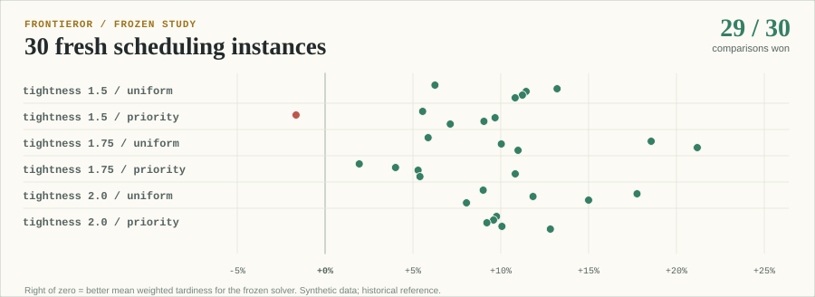

# Venkateshwar Reddy

I work on **autonomous research systems, optimization, and AI reliability**.

The question behind much of my recent work is what happens *before* an agent starts solving a problem: how it formulates the problem, chooses a meaningful experiment, changes its approach when evidence disagrees, and decides what its results actually establish.

[Website](https://venkat-rj.github.io/) · [Research code](https://github.com/Venkat-RJ?tab=repositories) · [LinkedIn](https://www.linkedin.com/in/venkateshwar-jambula/)

## Research

**[FrontierOR](https://github.com/Venkat-RJ/openresearch)** · Autonomous experimentation in combinatorial optimization

A factory-scheduling investigation using Sagent and Trackinizer, with Codex supporting the research infrastructure and validation. The final study froze the solver and evaluation protocol before generating fresh instances, and retained the comparisons, source, failures, and verification records.

<picture>
  <source media="(prefers-color-scheme: dark)" srcset="media/frontieror-dark.svg">
  <source media="(prefers-color-scheme: light)" srcset="media/frontieror-light.svg">
  
</picture>

The frozen C++ solver had lower mean weighted tardiness than the historical EGRASP comparator on 29 of 30 fresh synthetic instances. All 180 final runs were valid. This is a comparison within the tested synthetic distribution, not a general state-of-the-art claim.

[Study](https://github.com/Venkat-RJ/openresearch/tree/main/frontieror/scheduling-study) · [Methods and limitations](https://github.com/Venkat-RJ/openresearch/blob/main/frontieror/METHODS.md) · [Reproduction records](https://github.com/Venkat-RJ/openresearch/blob/main/frontieror/scheduling-study/README.md)

**[FACET](https://github.com/Venkat-RJ/facet-benchmark)** · Measuring attribution in multi-factor reasoning

An exploratory study of how different attribution probes change our assessment of a model's reasoning. Includes the paper, code, raw responses, and documented limits of the pilot.

[Paper](https://github.com/Venkat-RJ/facet-benchmark/blob/main/FACET_paper.pdf) · [Archived research materials](https://doi.org/10.5281/zenodo.19557436)

**[CoherenceBench](https://github.com/Venkat-RJ/coherencebench)** · Decisions across changing conditions

An exploratory test of whether an agent's decisions continue to track changing signals over long synthetic monitoring sessions. The current evidence is preliminary and specific to its evaluation setup.

[Replay](https://venkat-rj.github.io/coherencebench/)

## Building

**[Dexter's Laboratory](https://github.com/Venkat-RJ/dexters-laboratory-v1)** is an experimental research workspace built on [Lattice](https://github.com/leo1oel/lattice). It brings formulation, literature, branching experiments, bounded execution, validation, and the research record into the same local environment.

I'm interested in making the *process of investigation* inspectable, including experiments that fail, not just the final answer.

## Engineering contributions

I also work directly in other people's codebases. Recent examples include WebAssembly interpreter validation in **[Talos](https://github.com/cajal-technologies/talos)** (Lean), agent-message attribution and state visibility proposed for **[Sagent](https://github.com/rekursiv-ai/sagent)**, and deterministic report verification in **[TallySeal](https://github.com/Venkat-RJ/hermes-tallyseal)** for Hermes Agent.

[Selected Talos changes](https://github.com/cajal-technologies/talos/pulls?q=is%3Apr+author%3AVenkat-RJ) · [Sagent proposals](https://github.com/rekursiv-ai/sagent/pulls?q=is%3Apr+author%3AVenkat-RJ) · [TallySeal source](https://github.com/Venkat-RJ/hermes-tallyseal)

---

Previously, I founded PranaAlpha Labs. Earlier I worked across research, embedded systems, optimization, AI engineering, and technical leadership at Samsung Research, Bosch, Continental, and Sigmoid.

[Website](https://venkat-rj.github.io/) · [LinkedIn](https://www.linkedin.com/in/venkateshwar-jambula/)
